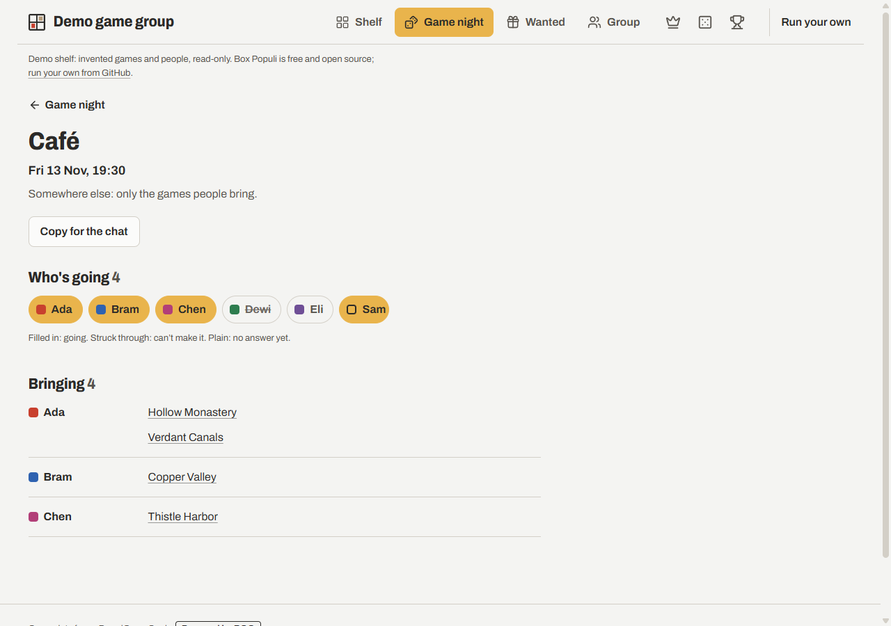
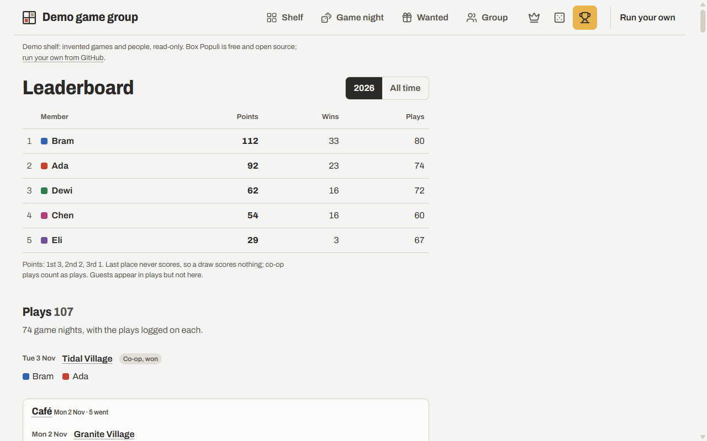
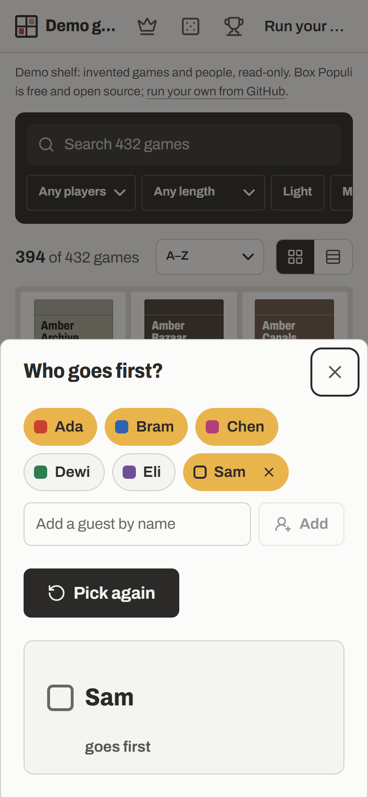
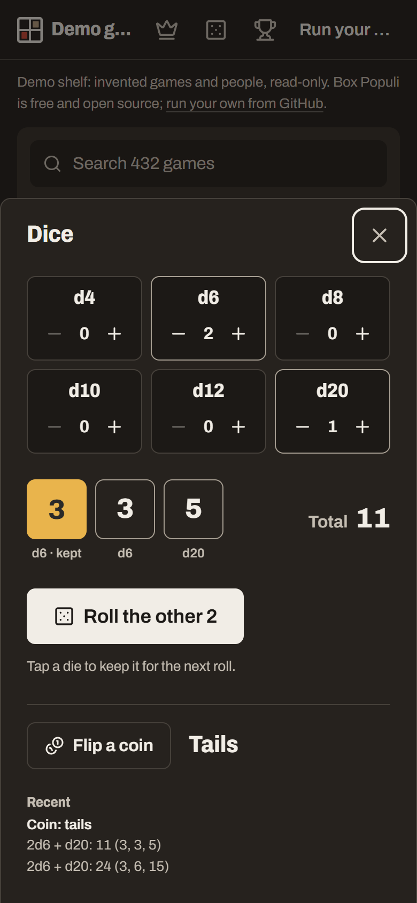

# Box Populi

A shared shelf for your board game group. Everyone adds the games they own, and Box Populi puts them together in one place, so you can see what the group has between you, find something that fits tonight, and stop asking "who has that one again?"

**Try it:** [box-populi.pages.dev](https://box-populi.pages.dev) has a demo group with invented games and people. There's nothing to sign up for.


## What your group gets

- **One shelf for everyone's games.** Each box has a coloured line for each friend who owns it.
- **Finding something to play.** Pick "4 players" and "fits in an hour", add "not too heavy" if you like, and the shelf shows only what fits.
- **Game night.** Plan a night, see who's coming and what they'll bring, and copy it all to the group chat. On the night, Play tonight suggests three games from what's actually there, guests' games included, or lets you choose and keep your own, plus quick fillers for while others arrive, split across tables if the group is too big for any of them.
- **Play log.** Note who played what and who won, with scores if you like, kept with the night you played them. A leaderboard with points for the podium, just for fun.
- **At the table.** Buttons at the top pick who goes first from the people there, guests included, and roll any mix of dice or flip a coin.
- **Wishlists and lending.** See which games someone wants that nobody in the group has yet, and who borrowed whose copy.
- **Rulebooks and videos.** Save the links once, next to the game, for everyone.
- **No accounts.** You join with the group's five-character code, your name and a six-digit PIN, which gets you back in on any device. No email, no password.
- **Your data stays yours.** Download your games, your plays and your game nights as spreadsheets whenever you like. Your games paste straight into another Box Populi.
- **Several groups, one shelf.** In two or more groups, switch between them from the top of the page; your games show in each.
- **Made for phones.** It's a website, so there's nothing to install, and it works on any phone or computer.

| | |
|---|---|
|  |  |






| | |
|---|---|
|  |  |


## Getting it for your group

Box Populi isn't an app you download or a website you sign up to. One person runs a copy of it for the group, and everyone else just uses the link they share.

**If someone already runs one,** ask them for your group's code or invite link, open it, and type your name and a PIN. That's all.

**If you'd like to run one,** you don't need to be a programmer. You'll create a free Cloudflare account and copy some commands into a terminal; the [setup guide](./SELF_HOSTING.md) writes out every step. Set aside 30 minutes to an hour. If you'd rather keep it on your own machine, it also runs in Docker on a home server, and it works on Vercel or Netlify too.

Once it's running, you create a group and share its code. Your friends never see any of the setup.

## Common questions

### Does it cost anything?

No. Box Populi is free and open source, and Cloudflare's free plan is plenty for a group of friends. There are no ads and no paid version.

### Do we need a BoardGameGeek account?

No. Without one, people search a free public database of games (Wikidata), paste a whole list of titles at once, or type games in, and the group can fill in anything that's missing. If the person running your copy registers their own BoardGameGeek application, everyone can also import their BGG collection in one go and get BGG's details, such as complexity and the best player counts.

### Who can see our games?

Only the people in your group. The person running the copy can pause or delete a group, but their admin page doesn't show who is in it or what they own. They do run the database, so like the owner of any website they could look at it directly. Each copy has a privacy page that lists what's stored.

### Can I be in more than one group?

Yes. Add your games once and they show in every group you're in. In two or more groups, the group name at the top of the page switches between them.

### When should we start a second group?

A group is the people who play together. They share one shelf, one play history and one leaderboard. Start another group when the people are different, such as a lunch crowd at work next to your Friday friends. A few people can be in both.

Keep one group when it's the same people on different days or in different moods. Plan each evening as a game night, and use the shelf's filters (players, time, weight) to find the long heavy games or the quick ones. Splitting the same people into two groups splits their history too, since plays and game nights each belong to one group.

### What if I get a new phone or clear my browser?

When you join you pick a six-digit PIN. On another device, open your group's link, tap your name and type it. Your account can also make a sign-in link to keep in a password manager.

Forgot your PIN and have no device that's still signed in? Ask your group's owner or a co-admin for a one-time sign-in code. If you're the owner, ask whoever runs the site. If the owner stops coming for 60 days, a co-admin can take over the group.

### Can we change how it looks?

Everyone can pick from twelve colour themes at the bottom of any page, a group can choose its own, and the person running the copy can add their own colours and logo.

## For developers

Box Populi is built with SvelteKit 3 and SQLite: Cloudflare D1 on Cloudflare, a plain file in Docker, or Turso on Vercel and Netlify. It runs one real group and the public demo; live BoardGameGeek data is waiting on BGG approving the application. Progress is in [STATUS.md](./STATUS.md).

To run it on your computer you need Node 22.18 or newer and pnpm:

```sh
pnpm install      # also creates wrangler.jsonc and .dev.vars from the examples
pnpm db:migrate   # local database
pnpm db:seed      # the demo group, with invented games
pnpm dev          # then open http://localhost:5173/demo
pnpm test
```

| File | For |
|---|---|
| [SELF_HOSTING.md](./SELF_HOSTING.md) | Running a copy, on every supported host. |
| [PRD.md](./PRD.md) | What it does and why. |
| [TECH.md](./TECH.md) | How it's built. |
| [DECISIONS.md](./DECISIONS.md) | Choices already made, and why. |
| [STATUS.md](./STATUS.md) | Progress and what's next. |
| [CHANGELOG.md](./CHANGELOG.md) | What changed in each version, and what an upgrade needs. |
| [AGENTS.md](./AGENTS.md) | Rules for coding agents working on it. |

## Credits

Game details come from [Wikidata](https://www.wikidata.org), which anyone may reuse, and, on copies connected to it, from [BoardGameGeek](https://boardgamegeek.com) under BGG's non-commercial API terms. Each copy uses its own BGG application. Box Populi isn't affiliated with BoardGameGeek.

## License

[MIT](./LICENSE) for the code. BoardGameGeek data shown by any copy stays under BGG's non-commercial terms.
